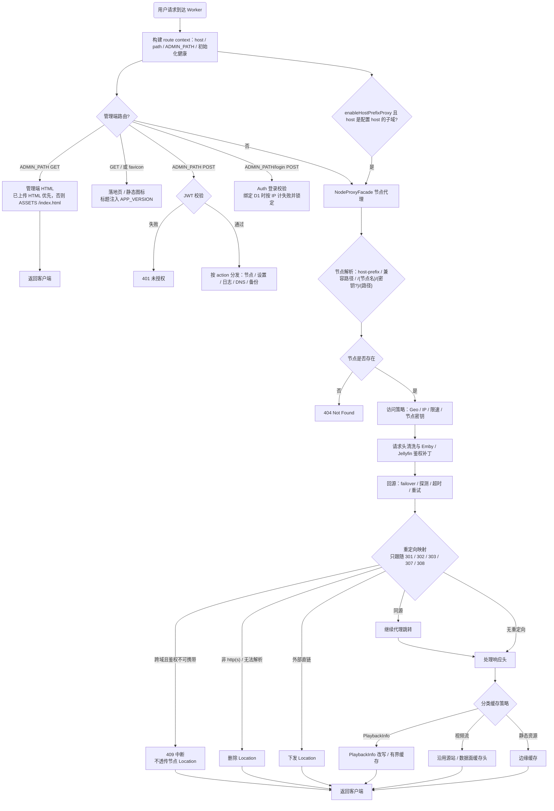

# 代理行为与缓存设计

README「工作原理」一节的展开版：请求如何转发、IP 隐藏到什么程度、直连与反代怎么混用、控制面与数据面如何分工、各类资源各自的缓存策略、播放链路的空闲超时，以及安全机制里的认证头兼容与真实 IP 透传细节。

日常使用只需要知道：源站 IP 被 Cloudflare 挡住，大视频流尽量不经过 Worker 内存，鉴权头在必要时会被改写成上游能接受的形式。下面是可以逐条对照实现的部分。

## 工作原理
客户端请求先到 Worker，Worker 根据 URL 中的节点名读取 KV 中的节点配置，再构造回源请求发送到 Emby 源站；源站响应由 Worker 流式回传给客户端。对普通 API、静态资源、视频流、重定向、WebSocket，会分别走不同的处理分支。

### IP 隐藏原理
Worker 作为公网入口，外部只能看到 Cloudflare 边缘节点，而不是你的 Emby 源站真实 IP。需要注意的是，这种“隐藏”是网络入口层面的隐藏，不等于完全匿名：Cloudflare 仍会追加自身请求头，源站 TCP 层看到的也仍然是 Cloudflare 网络。

默认情况下，项目在回源时会先清洗 `X-Real-IP` / `X-Forwarded-For` / `Forwarded` 以及 `Connection` / `Upgrade` 等易伪造或可能影响协议升级的请求头，再由 Worker 注入真实内容，方便上游日志审计与访问控制。

这里的“真实 IP”指的是客户端与 Cloudflare 建立连接时被 Cloudflare 识别到的来源 IP。它可以是用户本机的公网出口 IP，也可以是用户前置代理的出口 IP。默认情况下，节点会透传 `X-Real-IP` 和 `X-Forwarded-For`；项目注入的这两个请求头传达的是同一个真实 IP，其中 `X-Forwarded-For` 不是完整代理链。并且注入发生在节点自定义请求头之后，因此节点里新增同名请求头也不能覆盖这两个值。如果个别上游会按真实出口 IP、地区或 ASN 做风控，也可以在节点级改为仅保留 `X-Real-IP`、强制不透传【慎用】。

### 直连 / 反代混合原理
本项目不是“全量一刀切反代”。它支持：

- 节点默认走 Worker 中继
- 同源 30x 跳转继续代理
- 某些节点被显式标记为“源站直连节点”后，源站 2xx 可直接下发给客户端
- 命中网盘关键词或外链策略时，可直接把目标地址返回给客户端

这意味着它既能保留 Worker 统一入口，也能在带宽敏感场景下降低 Worker 中继成本。

### 控制面 / 数据面分离原理
这次架构调整的核心，是让 Worker 只做自己擅长的轻逻辑：

- **控制面（Worker）**：鉴权、路由、UI 渲染、元数据处理、轻量级预热、轻量缓存键清洗
- **数据面（Cloudflare 原生网关）**：视频主字节流、Range 断点续传、边缘缓存、Cache Rules 脱敏共享

对应到实现上，项目已经移除了 Worker 里对视频流的“黑洞式 drain”和大对象缓存倾向。海报、字幕、白名单播放列表继续在 Worker 层用 `caches.default` 做轻缓存；而视频本体则尽量保持薄透传，更依赖 Cloudflare 底层转发与 Cache Rules 配置，尤其建议为视频路径启用 **Ignore query string** 来实现跨用户共享缓存。

## 缓存与性能设计
### 1. 控制面与数据面分层
- **Worker 控制面**：只处理鉴权、路由、配置读取、UI、日志编排和轻量级元数据预热
- **Cloudflare 数据面**：承接视频主字节流、Range 请求、边缘缓存和底层硬件转发
- **内存缓存**：仅保留 `NodeCache / ConfigCache / NodesIndexCache / LogDedupe` 这类轻量元数据，不在 Worker 内缓存兆级视频对象

### 2. 资源分类缓存策略
- **图片 / 静态资源 / 字幕 / 白名单播放列表**：允许缓存或轻预热
- **`.mp4` / `.mkv` / `.ts` / `.m4s` 等视频主流**：不在 Worker 内做黑洞预取，不调用 `caches.default.put()` 存大对象
- **视频主流响应头**：Worker 对主字节流、`206`、播放列表和 smart-strm 响应一律下发 `Cache-Control: no-store`（`206` 的部分内容本就不能被共享缓存按偏移复用），缓存交给 Cache Rules 的“忽略源站并使用此 TTL”覆盖；如果你的规则选的是“遵循源站”，这些响应就不会被边缘缓存
- **音频字节流与视频同判定**：`/Audio/{id}/stream|universal|original|download|file` 和 mp3 / flac / aac 等扩展名按主字节流处理（直通、无 API 重试、`no-store`），不再落进 `isApiRequest`；`/Audio/{id}/Lyrics` 这类元数据仍走 API 分支
- **回源逐跳头不下发**：`connection` / `keep-alive` / `proxy-connection` / `te` / `trailer` / `transfer-encoding` 与 `Server`、`X-Powered-By` 一起在响应侧剔除；`Upgrade` 例外，101 握手会原样保留 `Connection: Upgrade`
- **Worker Cache Key**：会主动剥离 Token、设备号、客户端版本、播放会话等与媒体二进制无关的 Emby 状态参数
- **Cloudflare `cf` 提示**：回源 `fetch` 不附加任何 `cf` 字段（没有 `cacheEverything` / `cacheTtl`），不覆盖 Dashboard 里的 Cache Rules
- **编码响应不入元数据缓存**：带 `Content-Encoding`（gzip / br 等）的响应不写 `caches.default`，因为缓存命中路径不会跟客户端重新协商 `Accept-Encoding`
- **起播探测请求**：保留短时微缓存，减轻源站压力
- **受管流式响应**：播放列表连续 12 秒、媒体分片连续 15 秒没等到上游新数据时会中止上游流并记录 `stream_idle_timeout`；这段计时只覆盖“等上游读”的窗口，分片已经读出来、在队列里等客户端来取时不计时，所以慢客户端或暂停不会把上游连接误杀；客户端取消也会同步释放读取器和计时器

### 3. 轻量级元数据预热
- 预热目标：海报、白名单 `.m3u8` / `.mpd`、字幕等“导火索”资源
- 预热方式：通过 `ctx.waitUntil` 异步拉取并写入 `caches.default`
- 熔断策略：后台预热默认 `3 秒` 内拿不到响应就主动 `abort`，避免慢源站拖垮 Worker 后台连接池
- 并发策略：相同缓存键会加入已有 single-flight，整个 isolate 同时最多保留 4 个不同预热任务
- 字节预算：默认累计读取 4 MiB、可配置上限 8 MiB；响应声明大小或实际流式读取超过剩余预算时会主动取消
- 禁区：一旦识别为视频主字节流后缀，立即停止预热，不额外消耗 Worker 内存与 CPU
- 转码保护：包含 `Transcoding` 参数的 `m3u8`、或不在白名单路径内的播放列表，不会写入 Worker 缓存

### 4. 上传与重试策略
- 非 `GET/HEAD` 请求不会一律做内存缓冲重试。
- 只有当 `Content-Length` 明确存在且不超过 `256 KiB` 时，Worker 才会把请求体缓冲到内存里，便于安全重试。
- 大于该阈值、长度未知或缓冲失败时，会直接保留流式转发，避免大文件上传把 Worker 内存顶爆。

### 5. 直连与省流
通过节点级“主视频流策略”（`mainVideoStreamMode`，直连 / 代理 / 跟随全局）与“源站直连节点”名单，可以让不适合 Worker 中继的数据直接回到客户端，避免无意义的带宽绕行。跨域 30x 重定向则由鉴权能否随跳转携带自动决定是否继续代理。

## 安全机制

### 登录防暴力破解
绑定 D1 后，后台登录失败次数会写入 `auth_failures` 并按访问者 IP 计数；连续失败 5 次后锁定 **15 分钟**。未绑定 D1 时登录仍可使用，但失败次数不会持久化，因此不会形成跨请求锁定。

### 管理后台加固
- 支持通过环境变量 `ADMIN_PATH` 自定义后台入口，默认仍是 `/admin`
- 冷启动时会对 `JWT_SECRET` / `ADMIN_PASS` 做一次初始化健康检查
- 登录 Cookie 的作用域会收敛到管理路径前缀，而不是整个站点根路径

### 敏感操作二次确认
- DNS 修改 API 需要显式携带 `X-Admin-Confirm: saveDnsRecords`；兼容单条更新时仍可使用 `X-Admin-Confirm: updateDnsRecord`
- 同样需要 `X-Admin-Confirm` 的还有：`purgeCache`（清理 Cloudflare 缓存）、`exportConfig` / `exportSettings`（含密钥导出）、`clearLogs`（清理日志）、`repairD1Schema`（修复 D1 Schema）
- 管理面板已自动补这个请求头；如果你自己写脚本调用管理 API，也要一并带上

### 访问控制
支持以下控制方式：

- Geo 白名单 / 黑名单模式
- IP 黑名单
- 单 IP 请求限速
- CORS 限制

### 认证兼容修复
项目对 Emby / Jellyfin 媒体服务认证头做了兼容处理：

- 识别 `Authorization: Emby ...` 与 `Authorization: MediaBrowser ...`
- 兼容 `X-Emby-Authorization`（Emby 与 Jellyfin ≤11 读取；Jellyfin 12 默认不再读取）；`X-MediaBrowser-Authorization` 上游不读取，非 `passthrough` 模式下会被删除
- 节点级支持 `auto / emby / jellyfin / passthrough` 显式模式，便于兼容特殊上游
- 在特定 403 / 协议异常场景下做一次安全回退重试（仅媒体 GET 类请求）

节点编辑面板中的“媒体认证头模式”建议按下面理解：

- `auto`（默认推荐）：识别请求里已有的认证头家族；没有可识别 scheme 时，依次从 `X-Emby-Token` / `X-MediaBrowser-Token` / `Bearer` / 查询参数 `api_key`（或 `ApiKey`）提取 token，合成 `Authorization: MediaBrowser Token=...`（Emby 与 Jellyfin 都接受该 scheme），原 token 载体保留；已识别的 `Emby` scheme 会统一改写成 `MediaBrowser`，因为 Jellyfin 12 只接受后者，显式 `emby` 模式才保留 `Emby`
- `emby`：强制改写为 `Emby` 家族，直连重定向查询参数用 `api_key`
- `jellyfin`：强制改写为 `MediaBrowser` 家族，直连重定向查询参数用 `ApiKey`
- `passthrough`：完全透传（保留原始认证头），不改写 `Authorization` / `X-Emby-Authorization` / `X-MediaBrowser-Authorization`，适合你已确认上游需要保留原始头部的场景

> **Jellyfin 12 注意**：`EnableLegacyAuthorization` 默认关闭后，`X-Emby-Token`、`X-MediaBrowser-Token`、`X-Emby-Authorization`、`Emby` scheme 和 `api_key` 查询参数都会被上游忽略，只剩 `Authorization: MediaBrowser Token=...` 与 `ApiKey` 查询参数。`auto` 模式已自动补 `MediaBrowser` scheme；若客户端只把 token 放在 `api_key` / `ApiKey` 查询里、没有任何认证头，非 `passthrough` 模式的 Worker 会从查询参数提取 token 并补出 `Authorization` 头；若客户端发送的 `Authorization` / `X-Emby-Authorization` 只带设备信息、token 放在 `X-Emby-Token` 等头里，Worker 也会把 token 合并进 `Authorization`，这两种迁移场景都无需额外配置；`passthrough` 模式完全透传、不做改写。
>
> **直连回退**：只要客户端 Cookie 名称命中 `emby / jellyfin / mediabrowser / session / auth / token / credential / signature / secret` 等关键字，就判定为 Cookie 鉴权并回退到 Worker 代理，避免媒体鉴权丢失；代价是这部分流量不走直连。跨域重定向一律剥离客户端 `Authorization` 与 Cookie，只保留管理员显式配置的请求头。
>
> **节点地址**：Jellyfin 12 移除了 `/emby` 与 `/mediabrowser` 路由前缀，节点 `target` 建议直接填站点根（如 `https://jellyfin.example`）。Worker 的节点探测和上游 `Location` 映射会容忍多出来的 `/emby` 根，普通代理请求、PlaybackInfo 改写与元数据预热仍严格按配置的 `target` 基路径回源。
>
> **直连鉴权补全**：媒体直连重定向在客户端的媒体鉴权可随查询参数携带时（`Authorization` / `X-Emby-Authorization` 带 `Token=`、`X-Emby-Token` / `X-MediaBrowser-Token`，或 `api_key` / `ApiKey` 查询参数）才会把 token 补到跳转 URL（`auto` 同时补 `api_key` 与 `ApiKey`，`emby` 只补 `api_key`，`jellyfin` 只补 `ApiKey`）；携带私密鉴权 Cookie、非 Token `Authorization`（如 Basic）或 `X-Emby-Auth-Token` 等私密鉴权头的客户端不补。这类客户端遇到跨域跳转时，Worker 会在跳数用尽等中断点返回 409，而不是把无鉴权的节点 `Location` 透传给客户端。

### 上游真实 IP 透传控制

- 节点级支持 `realClientIpMode = forward / strip / disable`，其中 `forward` 在界面中显示为“透传 `X-Real-IP` 和 `X-Forwarded-For`”，`strip` 在界面中显示为“仅保留 `X-Real-IP`”，`disable` 在界面中显示为“强制不透传【慎用】”
- 项目会先清洗 `X-Real-IP` / `X-Forwarded-For` / `Forwarded` 以及 `Connection` / `Upgrade` 等请求头，再按配置注入真实内容，避免伪造并减少协议升级异常
- 这里的“真实 IP”指 Cloudflare 识别到的连接来源 IP，可以是用户直连出口，也可以是用户代理出口
- 真实客户端 IP 透传由 `X-Real-IP` 和 `X-Forwarded-For` 决定；默认情况下节点会透传这两个请求头，`forward` 与默认行为一致，其中 `X-Forwarded-For` 不是完整代理链，而是单个真实 IP
- 注入发生在节点自定义请求头之后，因此节点里新增同名请求头也不能覆盖 `X-Real-IP` / `X-Forwarded-For`
- `strip` 会仅保留 `X-Real-IP`，不补写 `X-Forwarded-For`；用于处理个别上游按 `X-Forwarded-For` 风控导致 `403/503` 的场景
- `disable` 会强制不透传 `X-Real-IP` 和 `X-Forwarded-For`；适用于个别上游不接受这两个请求头的场景，需谨慎使用

节点编辑面板中的“真实客户端 IP 透传”建议按下面理解：

- `forward`（界面显示为“透传 `X-Real-IP` 和 `X-Forwarded-For`”，默认推荐）：对当前节点透传 `X-Real-IP` 和 `X-Forwarded-For`
- `strip`（界面显示为“仅保留 `X-Real-IP`”）：对当前节点改为仅保留 `X-Real-IP`，不补写 `X-Forwarded-For`；用于处理个别上游按 `X-Forwarded-For` 风控时使用
- `disable`（界面显示为“强制不透传【慎用】”）：对当前节点强制不透传 `X-Real-IP` 和 `X-Forwarded-For`

## 请求处理流程图

> 重定向分支对应当前版本的 fail-closed 行为：跨域但客户端鉴权无法随跳转携带时返回 409，而不是透传无鉴权的节点 `Location`；非 http(s) 或无法解析的 `Location` 一律删除。详细分层见 [`architecture.md` 第 3 节](./architecture.md#3-请求生命周期)。

